# Architecture and flows

All diagrams are Mermaid and render on GitHub. For a file-by-file explanation of
each module, see [`docs/modules/`](modules/README.md).

1. [System context](#1-system-context)
2. [Control plane components](#2-control-plane-components)
3. [Authorization: every tenant-scoped request](#3-authorization-every-tenant-scoped-request)
4. [Workflow run with agents, tools and review gate](#4-workflow-run-with-agents-tools-and-review-gate)
5. [Agent graph query (Neo4j and Neptune)](#5-agent-graph-query-neo4j-and-neptune)
6. [Knowledge Graph page: build spec decides the flow](#6-knowledge-graph-page-build-spec-decides-the-flow)
7. [Ontology-first build job (control plane to graph-utility)](#7-ontology-first-build-job-control-plane-to-graph-utility)
8. [graph-utility build pipeline](#8-graph-utility-build-pipeline)
9. [Mapping proposals and approval profiles](#9-mapping-proposals-and-approval-profiles)
10. [Maker-checker lifecycles](#10-maker-checker-lifecycles)
11. [Tenants, personas and regulatory attributes](#11-tenants-personas-and-regulatory-attributes)
12. [Knowledge-base (RAG) grounding](#12-knowledge-base-rag-grounding)
13. [Data model](#13-data-model)
14. [Deployment (workshop account)](#14-deployment-workshop-account)
15. [How the repository modules relate](#15-how-the-repository-modules-relate)

---

## 1. System context

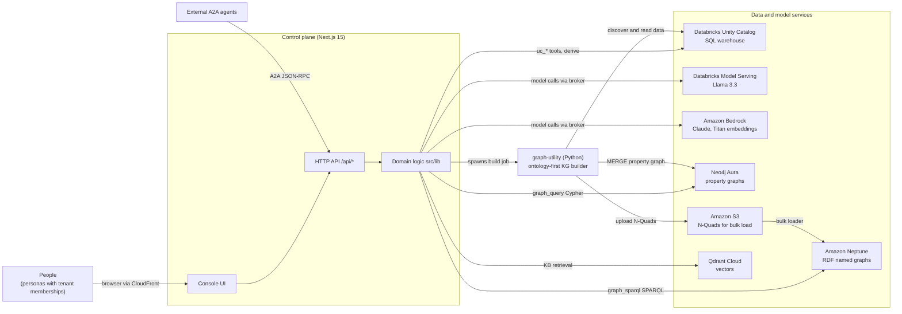

---

## 2. Control plane components

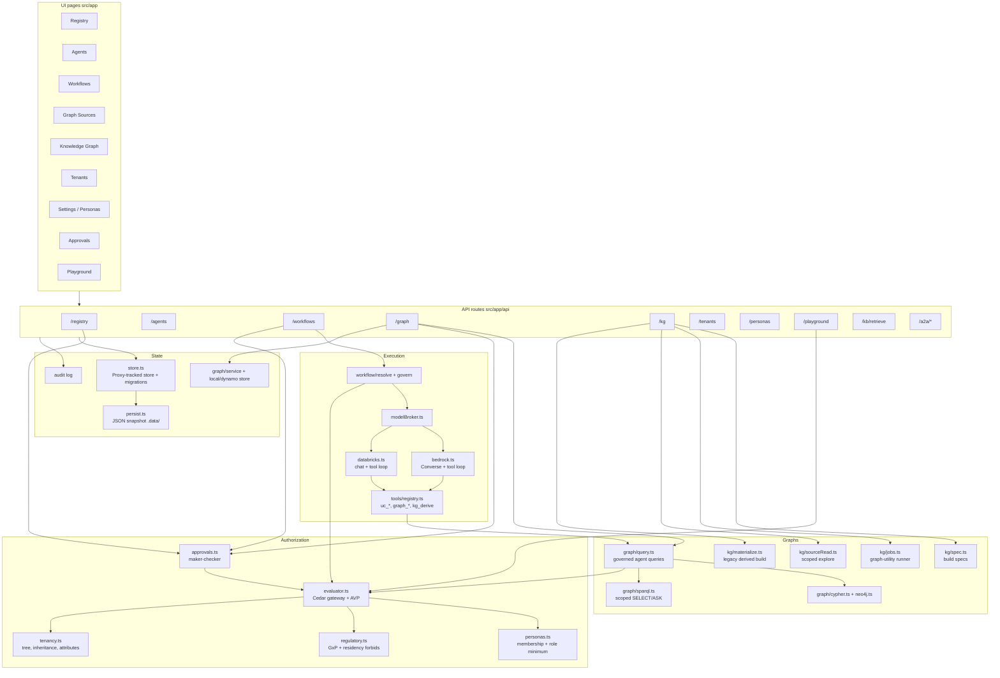

---

## 3. Authorization: every tenant-scoped request

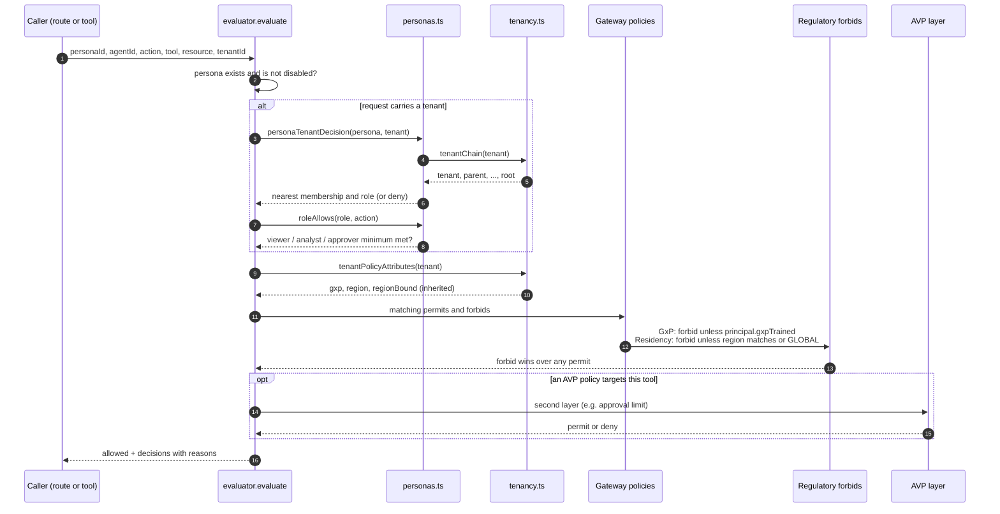

The order matters: **membership, then role, then policy**. No permit can let a
stranger into a tenant, and no BU permit can open GxP data to untrained staff.

---

## 4. Workflow run with agents, tools and review gate

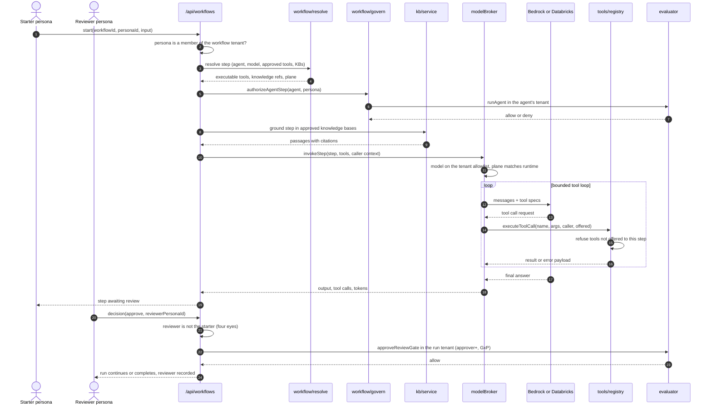

---

## 5. Agent graph query (Neo4j and Neptune)

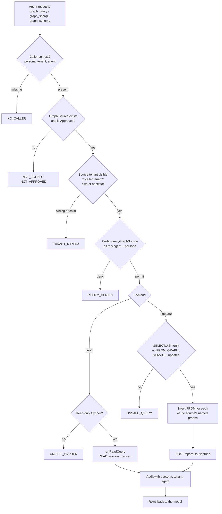

---

## 6. Knowledge Graph page: build spec decides the flow

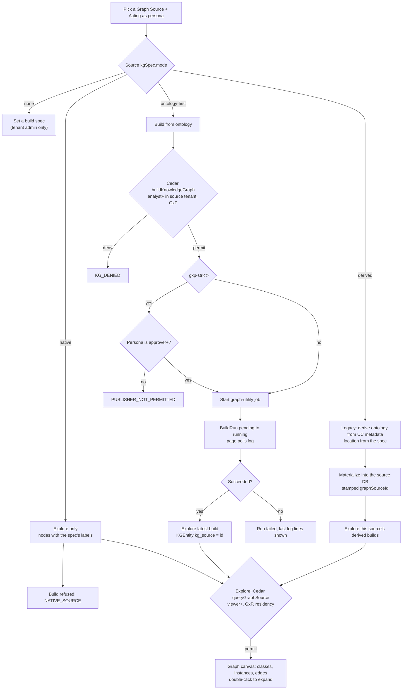

---

## 7. Ontology-first build job (control plane to graph-utility)

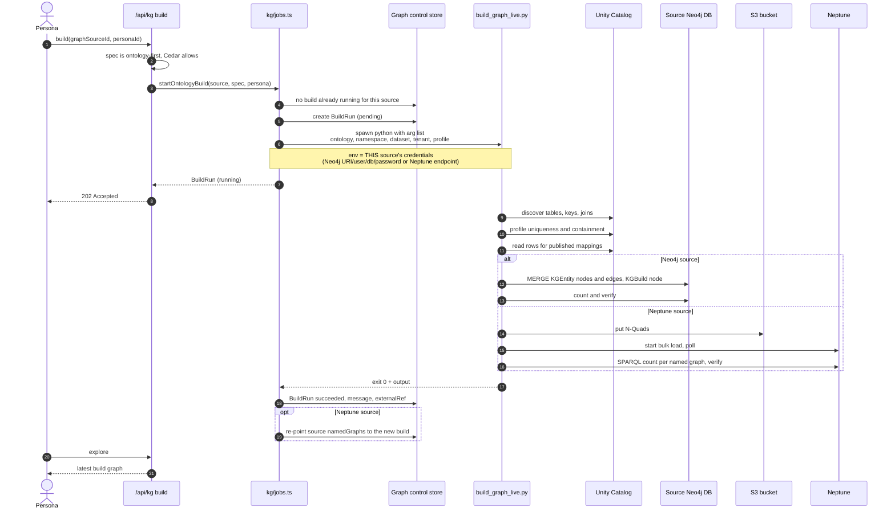

---

## 8. graph-utility build pipeline

```mermaid
flowchart LR
  subgraph inputs["Inputs"]
    ont["Ontology .ttl<br/>classes, properties,<br/>skos synonyms, owl:hasKey"]
    ds["Dataset"]
  end

  subgraph adapters["Data adapters"]
    uca["uc_adapter<br/>Unity Catalog"]
    csva["csv_adapter<br/>CSV directory"]
    mem["data_adapter<br/>in-memory fixtures"]
  end

  ds --> uca
  ds --> csva
  ds --> mem

  ofile["ontology_file<br/>RdfFileOntologyClient"]
  ont --> ofile

  disc["discover()<br/>tables, columns, declared keys, joins"]
  uca --> disc
  csva --> disc
  mem --> disc

  prop["mapping.propose_mappings<br/>term_match: name / label / partial<br/>class, property, relationship,<br/>value-class, value relationship"]
  ofile --> prop
  disc --> prop

  ovl["overlap<br/>owl:hasKey probe, uniqueness,<br/>join containment"]
  prop --> ovl

  auto["mapping.auto_approve<br/>approval profile"]
  ovl --> auto

  pub["publish_mappings<br/>approved + valid only"]
  auto --> pub

  matz["materialize_graph<br/>typed nodes, literals, edges,<br/>value entities"]
  pub --> matz

  rsn["reason<br/>entail + validate constraints"]
  matz --> rsn

  gates{"Gates<br/>conflation, dangling,<br/>truncation, violations"}
  rsn --> gates
  gates -- refused --> stop["BuildRefused"]
  gates -- pass or waived --> nq["N-Quads<br/>data, :inferred, :prov"]

  nq --> n4l["neo4j_load<br/>plan + MERGE + verify"]
  nq --> npl["neptune_load<br/>S3 + bulk loader + verify"]
  nq --> file["--out file"]
  n4l --> reg["--register<br/>Draft Graph Source in control plane"]
  npl --> reg
```

---

## 9. Mapping proposals and approval profiles

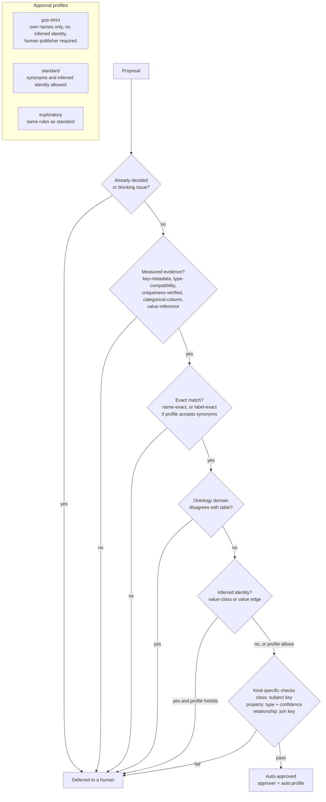

---

## 10. Maker-checker lifecycles

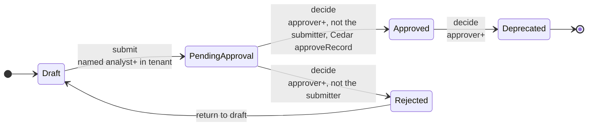

Registry records and Graph Sources use this lifecycle. Records with no tenant
are decided at the org root (`takeda`).

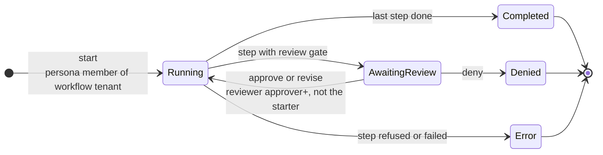

---

## 11. Tenants, personas and regulatory attributes

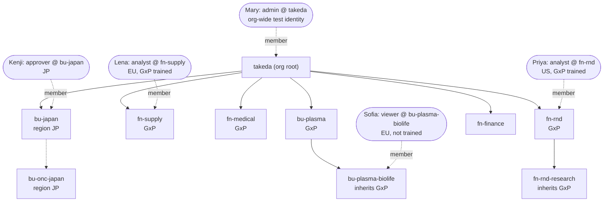

The rules this diagram encodes:
- **Membership flows down:** a membership covers the tenant and every tenant beneath it, never a sibling or a parent.
- **The nearest membership sets the role** when several cover a tenant.
- **Regulatory attributes are inherited:** `gxp` and `dataRegion` come from the nearest tenant that sets them.

---

## 12. Knowledge-base (RAG) grounding

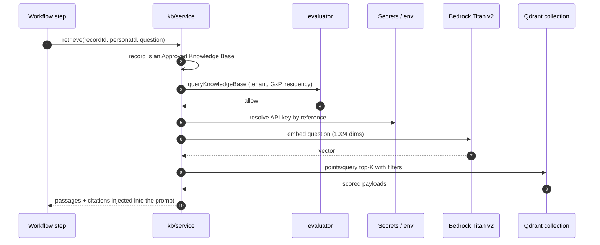

---

## 13. Data model

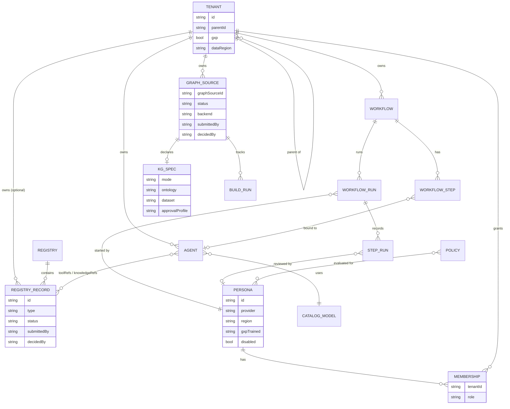

---

## 14. Deployment (workshop account)

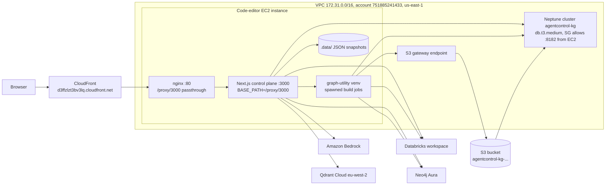

---

## 15. How the repository modules relate

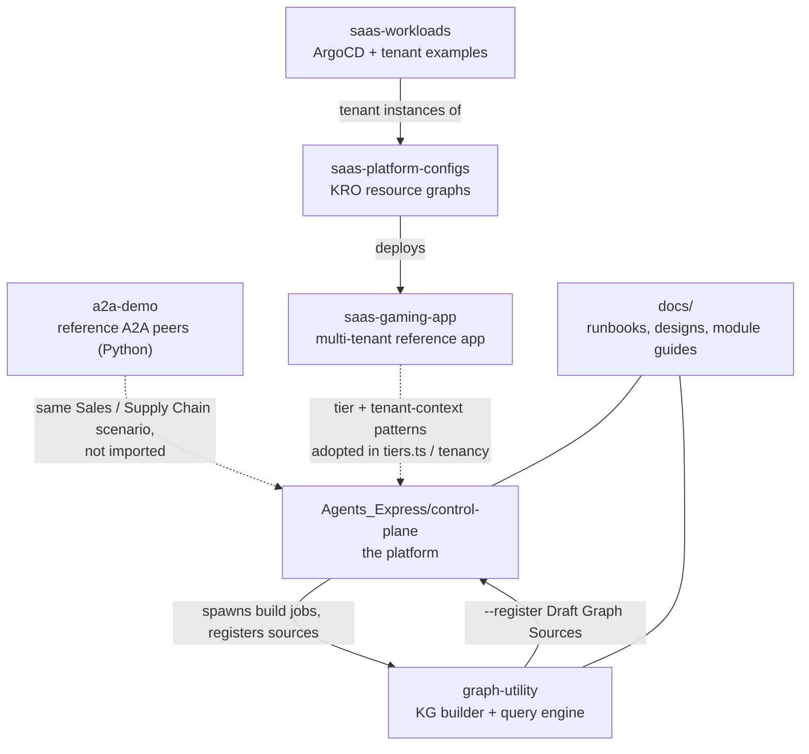

Solid arrows are runtime connections. Dotted arrows are design lineage: patterns
that were adopted, but code that is not imported.
