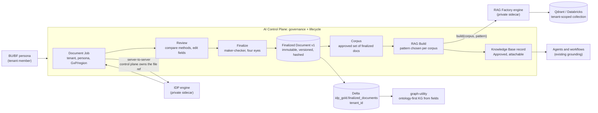
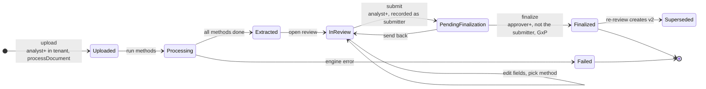
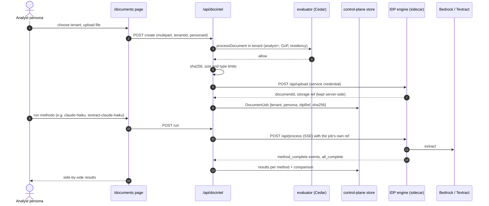
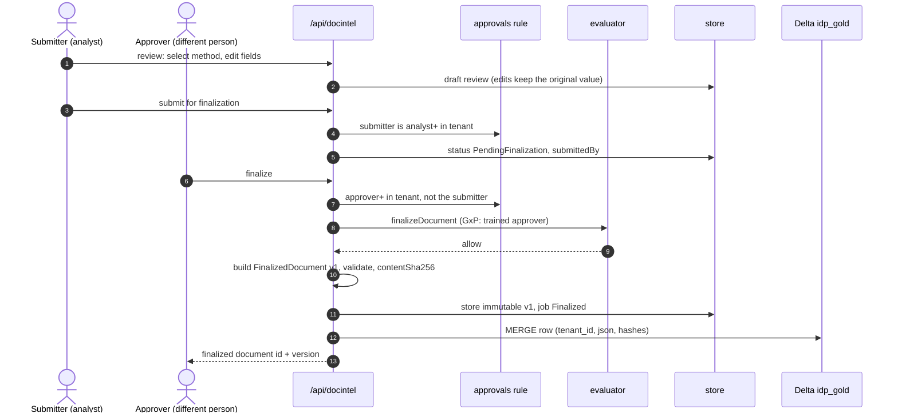
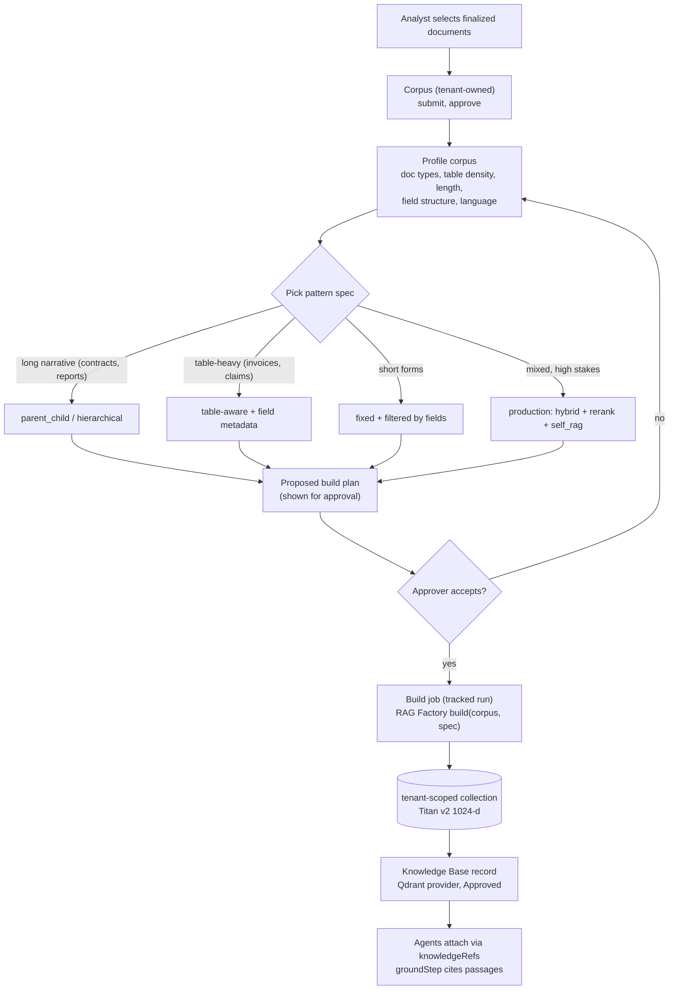
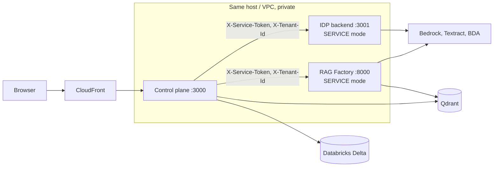
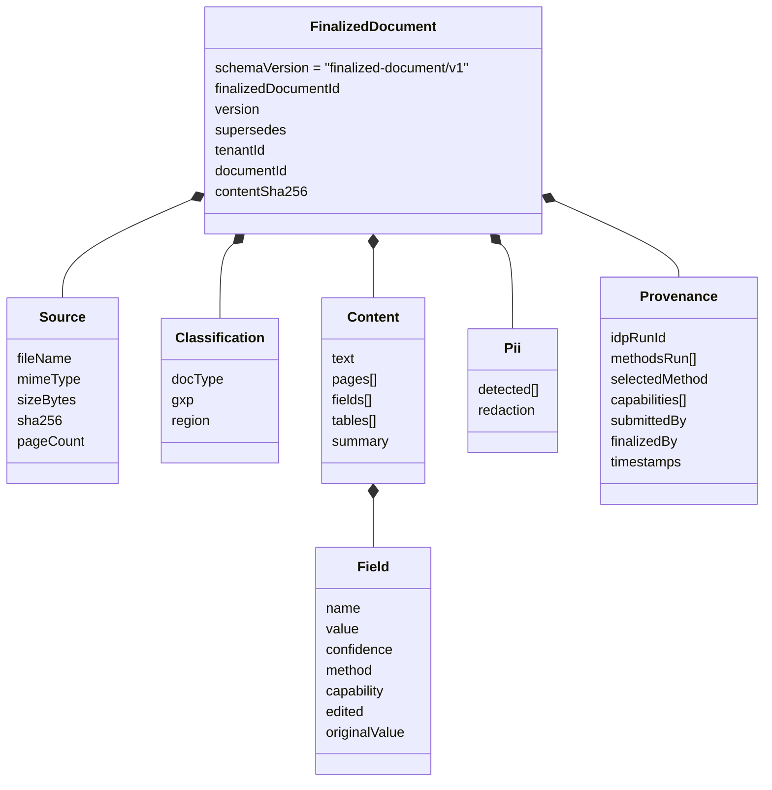

# Integrating IDP and the RAG AI Factory into the AI Control Plane

**Goal.** Every Takeda BU/BF can process documents with **IDP** (Intelligent
Document Processing). When a user **finalizes** IDP results, the **RAG AI
Factory** builds a retrieval pipeline from them, and agents use it. Both are
exposed as **separate control-plane modules**, governed like everything else
(tenants, personas, Cedar, GxP/residency, maker-checker, audit).

Source repositories (cloned outside this repo):

| Repo | What it is today |
|---|---|
| `Ramu-DE/IDP_latest` | TypeScript workbench: upload, ~20 extraction methods on Bedrock / Textract / BDA side by side, compare, pipeline + code generation, RAG indexing (Databricks Delta or Qdrant). Express API on :3001 + React. |
| `Ramu-DE/rag-ai-factory` | Python proof of concept: its own OCR → classify → skills → validate, Qdrant ingest, 32 RAG pattern classes, FastAPI on :8000 + Streamlit. |

---

## 1. Findings that shape the design

| | IDP | RAG Factory |
|---|---|---|
| Finalize / review state | **none** | **none**; no contract for consuming external results |
| Tenants / roles | none (`{alias, email}`, admin allow-list) | optional `tenant_id` filter, not enforced; no auth, CORS `*` |
| Pattern selection | n/a | chosen **per query** by regex/LLM and then **not executed** (always dense top-k) |
| Security blockers | client-supplied `s3Uri` lets a caller read any bucket the role can see; `local://` path traversal; `/api/files/*` unscoped; RAG endpoints global; agent server unauthenticated; raw PII persisted | multi-document overwrite bug in the incremental index; silent in-memory Qdrant; a **committed Mindee API key** |
| Reusable strengths | multi-method extraction + comparison, Guardrails PII redaction, chunking/embedding (Titan v2, 1024-d), Databricks medallion | skills, field validator, guards, local OCR/NER, 32 pattern classes, spec model |

Neither repo can be exposed to BUs as is. Together they hold the right
**engines**. Everything they lack is what the control plane already does.

## 2. The design: the control plane owns the lifecycle, the repos are engines

Principles:

1. **Users talk only to the control plane.** IDP and the factory run as private
   services reached server-to-server with a service credential. Identity,
   policy and audit live in one place.
2. **The control plane owns every reference.** IDP never receives a
   client-supplied URI. It gets the file reference the control plane created.
   That closes IDP's arbitrary-read path at the boundary, independently of
   fixing it inside IDP.
3. **"Finalized" is a control-plane artifact** (`FinalizedDocument v1`).
   Neither engine has the concept. It is immutable and versioned, carries
   provenance, and is approved by a different person than the submitter.
4. **Pattern selection moves from per-query to per-corpus**, and the chosen
   pattern is what actually runs.
5. **Reuse, don't rebuild:**

| Need | Existing control-plane piece |
|---|---|
| who may use it | personas, memberships, role minimums |
| GxP / region | `pol-gw-gxp-training`, `pol-gw-data-residency` |
| finalize / corpus approval | `approvals.ts` four-eyes rule |
| long jobs | the BuildRun + job-runner pattern (`kg/jobs.ts`) |
| RAG for agents | Knowledge Base records + `groundStep` |
| record of everything | audit log |

## 3. Document lifecycle

## 4. Processing sequence (Phase 1)

## 5. Review and finalization (maker-checker)

## 6. RAG Factory flow (Phase 2)

The factory embeds with Titan v2 (1024-d), the same as the control plane's KB
retrieval, so a built collection registers directly as an existing Qdrant
Knowledge Base record.

## 7. Deployment shape

Neither sidecar is published through CloudFront. In service mode they refuse
any request without the shared service token, and they record the tenant the
control plane asserts.

## 8. `FinalizedDocument v1`: the contract

Schema: [`docs/contracts/finalized-document.v1.schema.json`](contracts/finalized-document.v1.schema.json).
TypeScript type and validator: `Agents_Express/control-plane/src/lib/docintel/contract.ts`.

Rules the contract enforces:

- **Immutable.** A change is a new `version` with `supersedes` pointing at the previous one.
- **Content hash.** `contentSha256` is a hash over the canonical JSON of `content`, so a consumer can verify it received exactly what was approved.
- **Edits keep evidence.** Every edited field keeps its `originalValue`, plus the `method` / `capability` that produced it.
- **Four eyes.** `provenance.submittedBy` and `provenance.finalizedBy` must be different people.
- **Regulatory attributes travel with the document.** `classification.gxp` / `region` are copied from the tenant at finalization time, so downstream builders inherit them.
- **PII state is explicit.** It is `none-detected`, `redacted` or `retained`, never implied.

## 9. Phased plan

| Phase | Deliverable | Status |
|---|---|---|
| **0. Contract + hardening** | `FinalizedDocument v1`. **IDP:** service-mode auth, only server-issued storage refs (no arbitrary bucket, no traversal), tenant recorded on runs/chunks, file reads scoped, agent server protected. **Factory:** per-document incremental index (overwrite fix), service-mode auth, tenant enforced, no silent in-memory store, committed key removed from files. | **done**: local branch `hardening/service-mode` in each repo, not pushed. IDP: 207/208 unit tests (the one failure is pre-existing on `main`). Factory: 25/25, plus `POST /ingest/finalized` |
| **1. Document Intelligence module** | Upload → run methods (IDP sidecar) → compare → review/edit → submit → finalize (four eyes, GxP) → `FinalizedDocument v1` in the control plane + Delta | **done**: `/documents`, `/api/docintel`, `lib/docintel/*`; 12 unit tests; verified live on 2026-10-24 (see below) |
| **2. RAG Factory module** | Corpus → profile → proposed pattern → approve → build job → tenant collection → KB record → agents | **done**: `/rag`, `/api/ragfactory`, `lib/ragfactory/*`; factory branch `phase2/corpus-patterns`; 7 control-plane + 8 factory tests; verified live on 2026-10-24 (see below) |
| 3. KG from documents | Finalized fields in Delta → graph-utility ontology-first build | planned |
| 4. Production | Entra ID sign-in, a queue for large batches, Mosaic AI Vector Search, IDP's IaC repaired | planned |

### Phase 1 live verification (2026-10-24)

The control plane ran against the IDP sidecar in service mode (`127.0.0.1:3001`) with real Bedrock in us-east-1, and published to Databricks.

1. Sofia (not a member of `fn-rnd`) was refused at upload. Priya (analyst, `fn-rnd`) uploaded a one-page invoice PDF. The response held no `idpRef`.
2. `claude-haiku` and `nova-lite` both completed in about 4 s each. Haiku (confidence 0.95, $0.0048) was selected automatically over Nova Lite (0.30, $0.0011). The draft had 6 fields, a 2-row table, docType `invoice` and 2 PII types.
3. Priya changed `payment_terms` from Net 30 to Net 45 and submitted. The finalized record keeps `originalValue: "Net 30"`.
4. Finalize was refused for Priya (four-eyes rule) and for Omar (approver, but not in the tenant). Daniel (approver, `fn-rnd`, GxP-trained) finalized it as `fd-zef2zykj` v1, with `gxp: true` taken from the tenant.
5. The row was read back from `workspace.idp_gold.finalized_documents`. Python's `json.dumps(sort_keys=True, separators=(",",":"), ensure_ascii=False)` gives the same `contentSha256`, so the RAG Factory's `/ingest/finalized` will accept the document.
6. With valid service headers, the sidecar refused these refs: `../` traversal (400), an absolute path (403), another tenant's upload (403), a foreign bucket (403), and another tenant's `/api/files` (404).
7. Control-plane `npm test` passed 465/465 and the smoke test passed 100/100.

### Phase 2 live verification (2026-10-24)

The control plane drove the RAG Factory sidecar in service mode (`127.0.0.1:8000`), with Qdrant Cloud and Bedrock (Titan v2 embeddings, Claude Sonnet 4.6 answers).

1. A second document (a Certificate of Analysis: 12 fields, a 5-row results table) was finalized through Phase 1.
2. Priya selected both finalized documents. The profile (9 fields on average, tables in 2 of 2 documents, 391 characters of text) recommended **Structured fields + tables**. Sofia (not a member) could not create a corpus.
3. Priya submitted the corpus. Self-approval was refused. Daniel approved it, and the build ran `structured_chunking` into `cp_fn-rnd_corp-12n58srt` (3 + 4 chunks). It registered the Approved Knowledge Base `RAG_R_D_supplier_and_QA_documents_12n58srt`, with Priya as submitter and Daniel as decider.
4. "Assay result for batch VF-24-0917, released?" returned 99.4 % within 95.0–105.0 %, released, faithfulness 1. The top hits were the fields, text and table chunks of the certificate. The invoice question (filter `doc_type=invoice`) found a real inconsistency: the reviewed field said Net 45 but the text still said Net 30. Lena (another tenant) was refused.
5. Priya corrected the text and submitted v2. Daniel finalized it. The corpus (following new versions) re-ingested v2 at once, without re-approval: 3 chunks in, 3 v1 points removed. The same question then answered **Net 45** and cited only v2.
6. The Knowledge Base works through the platform's own `/api/kb/retrieve`, the path agents use. That check exposed a gap that predates this work: KB retrieval was evaluated without the record's tenant, so any persona could read a tenant's KB. It is now evaluated in the record's tenant, so Lena and Kenji are denied. Platform-provided KBs are unchanged.
7. `npm test` passed 472/472, the smoke test passed 100/100, and the factory suite passed 33/33.

Runtime: `~/.config/agentcontrol/start-idp.sh` and `start-raf.sh` start the sidecars from `idp.env` and `raf.env` (mode 600; they hold each `SERVICE_TOKEN`, and `raf.env` also holds the Qdrant credentials). `start.sh` launches both if they are not already listening. The control plane reads `IDP_URL`, `IDP_SERVICE_TOKEN`, `RAG_URL` and `RAG_SERVICE_TOKEN` from `~/.config/agentcontrol/env`. Both files live outside the repo.

## 10. Things only the owner can do

- **Revoke the Mindee API key** committed in `rag-ai-factory`
  (`build_mindee_capabilities_xlsx.py`, `docs/Mindee_Capabilities.xlsx`).
  Removing it from the files does not remove it from git history.
- **Decide whether to push** the hardening branches to the two source repos.
