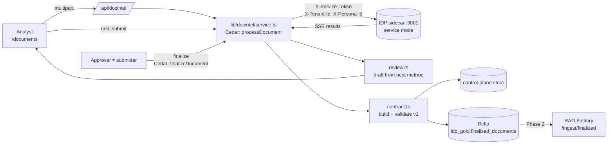

# Document Intelligence module

Any BU or BF can use this module to turn documents into reviewed, approved, structured records.
- **Extraction:** the IDP engine (`IDP_latest`) does it, running as a private sidecar.
- **Decisions:** the control plane makes them: who may upload, who may review, who may finalize, and what the finalized record looks like.

The output is a `FinalizedDocument v1`, which the RAG Factory and Delta consume. Design and diagrams: [../../IDP_RAG_INTEGRATION.md](../../IDP_RAG_INTEGRATION.md). Contract: [../../contracts/finalized-document.v1.schema.json](../../contracts/finalized-document.v1.schema.json).

## Flow

## Governed actions

| Action | Minimum role | Used for |
|---|---|---|
| `viewDocument` | viewer | list and read jobs and finalized documents |
| `processDocument` | analyst | upload and run IDP methods |
| `reviewDocument` | analyst | edit the review and submit it |
| `finalizeDocument` | approver | finalize or send back; never the submitter |

- **Tenant:** every action is evaluated in the document's tenant, against tool `docintel`.
- **Layer 0:** the evaluator checks membership and the role minimum.
- **Permit:** `pol-gw-docintel` allows the four actions.
- **GxP and residency:** the GxP-training and data-residency forbids include all four actions, so in a GxP tenant only GxP-trained personas can finalize.

## Files

| File | Why it exists |
|---|---|
| `src/lib/docintel/contract.ts` | The v1 TypeScript types, `canonicalJson` and `contentSha256` (byte-identical to Python's `json.dumps(sort_keys=True, separators=(",",":"), ensure_ascii=False)`), and a validator that collects every error. Nothing leaves the control plane without passing it. |
| `src/lib/docintel/model.ts` | The `DocumentJob` record: status, method runs, review, submitter, versions. `publicJob()` strips `idpRef`, the engine's storage reference. Only the server may tell IDP which file to read. |
| `src/lib/docintel/idpClient.ts` | Server-to-server client: upload, then process. It parses IDP's SSE stream into one `MethodRun` per requested method; a method that returned nothing becomes an explicit error. |
| `src/lib/docintel/review.ts` | Normalises IDP's untyped output (objects, key/value lists, `Key: value` text, CSV, Markdown and HTML tables) into fields and tables. A field the reviewer edits keeps the machine's value in `originalValue`. |
| `src/lib/docintel/service.ts` | The lifecycle and all governance: file type and size limits, sha256, background extraction, best-method selection, review and submit, the four-eyes finalize, versioning (`supersedes`), and GxP and region taken from the tenant. |
| `src/lib/docintel/delta.ts` | Idempotent parameterized `MERGE` into `<catalog>.idp_gold.finalized_documents`, with change data feed on. The result (`written`, `skipped` or `failed`) is stored on the record, so a failed publish is never silent. |
| `src/app/api/docintel/route.ts` | Thin HTTP layer: GET (list, detail, finalized, health) and POST (multipart upload; `run`, `review`, `submit`, `sendBack`, `finalize`). |
| `src/app/documents/page.tsx` | UI: Acting as, tenant, upload, method and capability choice, comparison table, review editor, finalize or send back, finalized JSON. |
| `tests/docintel.test.ts` | Contract, hash, normalisation, SSE, and governance (four eyes, cross-tenant, GxP, versioning, failed publish). |

## Lifecycle

`uploaded → processing → extracted | failed → in-review → pending-finalization → finalized`

- **Send back:** returns `pending-finalization` to `in-review`, with a note.
- **Corrections:** editing a finalized document and submitting again produces version N+1 with `supersedes` set. Earlier versions never change.

## Running it

| Component | How it runs |
|---|---|
| Sidecar | `~/.config/agentcontrol/start-idp.sh`. It runs the IDP backend from `/home/participant/external/IDP_latest`, branch `hardening/service-mode`, with `SERVICE_TOKEN`, `USE_LOCAL_STORAGE=true` and `AWS_REGION=us-east-1`. |
| Control plane | Reads `IDP_URL` and `IDP_SERVICE_TOKEN` from `~/.config/agentcontrol/env`. |
| Delta | Uses the existing `DATABRICKS_HOST` and `DATABRICKS_TOKEN`. To change the target, set `DOCINTEL_DELTA_CATALOG` (default `workspace`) and `DOCINTEL_DELTA_SCHEMA` (default `idp_gold`). |
| Health | `GET /api/docintel?health=1` reports IDP reachability and the Delta target. |
