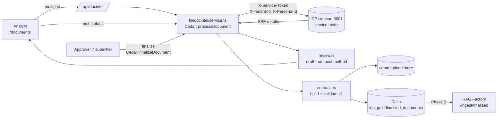
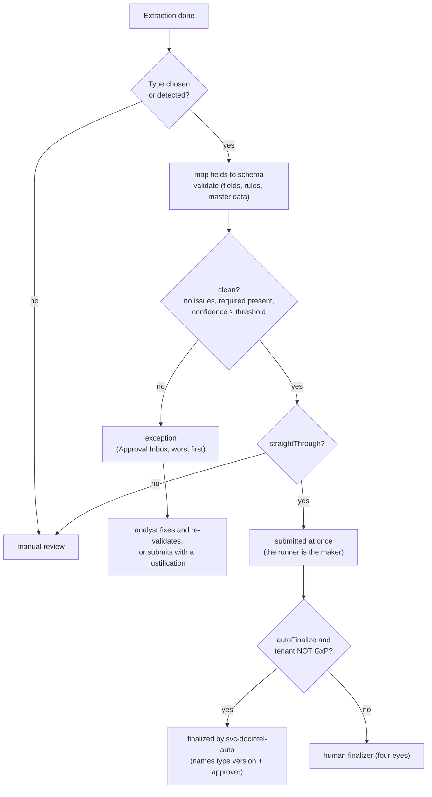

# Document Intelligence module

Any BU or BF can use this module to turn documents into reviewed, approved, structured records.
- **Extraction:** the IDP engine (`IDP_latest`) does it, running as a private sidecar.
- **Decisions:** the control plane makes them: who may upload, who may review, who may finalize, and what the finalized record looks like.

The output is a `FinalizedDocument v1`, which the RAG Factory and Delta consume. Design and diagrams: [../../IDP_RAG_INTEGRATION.md](../../IDP_RAG_INTEGRATION.md). Contract: [../../contracts/finalized-document.v1.schema.json](../../contracts/finalized-document.v1.schema.json).

## Flow

## Document Types, validation and routing (P1–P3)

A **Document Type** says what a kind of document must contain, how it is checked, and how it is routed. It is the governed counterpart of an IDP vendor's "skills".

**Owner.** A tenant owns each type, and it is inherited by every tenant beneath it. The org root publishes **Certificate of Analysis** and **Supplier invoice**, so every BU and BF has them.

**Lifecycle.** A type is edited as a **draft**, submitted, and **published as version N+1** by a different approver (approver+). Documents always use the published version, and the finalized record names it.

**What a type contains:**

| Part | Contents |
|---|---|
| Fields | name, label, type (`text`, `number`, `money`, `percent`, `date`, `enum`), required, format (regex), synonyms / allowed values. Extracted names are mapped onto the schema through synonyms. |
| Rules | declarative only, with no expressions: `date_order`, `range`, `sum_equals` (line items add up to the total), `spec_within` (each result meets its specification: ranges, NLT / NMT, "Complies"), `master_data` (the value exists in a Unity Catalog table, optionally with a status; read-only and parameterised) |
| Severity | `block` or `warn`, per rule |
| Methods and capabilities | used when the type is chosen at upload |
| Routing | `minConfidence`, `straightThrough`, `autoFinalize` |

**Rules for people:**
- **Blocking issues** stop a submission unless the submitter records a **justification** (10+ characters). The justification is kept in the audit trail and in the finalized record (`validation.override`).
- **Validation re-runs** on every review save, on submit, and on demand ("Re-validate").
- **Auto-finalize never applies in a GxP tenant.** It also needs a published type that allows it and a clean result. Currently every live tenant inherits GxP from the `takeda` root, so auto-finalize is inactive in this deployment.

**Contract.** `FinalizedDocument v1` gains two optional, additive sections:
- `documentType` `{id, key, name, version}`
- `validation` `{clean, route, issues, override}`

The schema stays `finalized-document/v1`, and the validator requires an override whenever there are blocking issues.

**Master data.** The seeded invoice type checks the supplier against `workspace.idp_reference.suppliers`. That table was created for this demo with three suppliers: ACME Lab Supplies (approved), Globex Reagents (approved) and Initech Labware (suspended). Point the rule at the real vendor master to use it in production.

## Quality dashboard (P7)

`/documents/quality` (`GET /api/docintel?analytics=1`) is computed from stored jobs and finalized records, scoped to what the persona may view. It shows:

| Group | Measures |
|---|---|
| KPI tiles | documents, finalized, straight-through rate (finalized with no analyst edits), fields corrected, open exceptions, median time to finalize, extraction cost |
| Per document type | the KPIs above, plus exceptions, overrides and cost per document |
| Per method | runs, success rate, latency, cost, confidence, times chosen for review, fields corrected when chosen |
| Lists | most-corrected fields (with an example), most frequent validation issues |

## Governed actions

| Action | Minimum role | Used for |
|---|---|---|
| `viewDocument` | viewer | list and read jobs and finalized documents |
| `processDocument` | analyst | upload and run IDP methods |
| `reviewDocument` | analyst | edit the review and submit it |
| `finalizeDocument` | approver | finalize or send back; never the submitter |
| `manageDocumentType` | analyst | draft, edit, submit a Document Type |
| `approveDocumentType` | approver | publish or reject a draft, deprecate; never the submitter |

- **Tenant:** every action is evaluated in the document's tenant, against tool `docintel`.
- **Layer 0:** the evaluator checks membership and the role minimum.
- **Permit:** `pol-gw-docintel` allows the four actions.
- **GxP and residency:** the GxP-training and data-residency forbids include all four actions, so in a GxP tenant only GxP-trained personas can finalize.

## Files

| File | Why it exists |
|---|---|
| `src/lib/docintel/contract.ts` | The v1 TypeScript types, `canonicalJson` and `contentSha256` (byte-identical to Python's `json.dumps(sort_keys=True, separators=(",",":"), ensure_ascii=False)`), and a validator that collects every error. Nothing leaves the control plane without passing it. |
| `src/lib/docintel/model.ts` | The `DocumentJob` record: status, method runs, review, submitter, versions. `publicJob()` strips `idpRef`, the engine's storage reference. Only the server may tell IDP which file to read. |
| `src/lib/docintel/idpClient.ts` | Server-to-server client: upload, then process. It parses IDP's SSE stream into one `MethodRun` per requested method; a method that returned nothing becomes an explicit error. |
| `src/lib/docintel/review.ts` | Normalises IDP's untyped output (objects, key/value lists, `Key: value` text, CSV, Markdown and HTML tables) into fields and tables. A field the reviewer edits keeps the machine's value in `originalValue`. |
| `src/lib/docintel/service.ts` | The lifecycle and all governance: file type and size limits, sha256, background extraction, best-method selection, review and submit, the four-eyes finalize, versioning (`supersedes`), and GxP and region taken from the tenant. |
| `src/lib/docintel/delta.ts` | Idempotent parameterized `MERGE` into `<catalog>.idp_gold.finalized_documents`, with change data feed on. The result (`written`, `skipped` or `failed`) is stored on the record, so a failed publish is never silent. |
| `src/app/api/docintel/route.ts` | Thin HTTP layer: GET (list, detail, finalized, health) and POST (multipart upload; `run`, `review`, `submit`, `sendBack`, `finalize`). |
| `src/app/documents/page.tsx` | UI: Acting as, tenant, upload, method and capability choice, comparison table, review editor, finalize or send back, finalized JSON. |
| `src/lib/docintel/validation.ts` | Pure, declarative validation: number, date and specification parsers, field-to-schema mapping, field checks, rules, and master-data lookup (injected). |
| `src/lib/docintel/doctypes.ts` (+ `doctypes-seed.ts`) | Document Type model and governance (draft → published versions, four eyes), inheritance down the tenant tree, classification to a type, and the Unity Catalog master-data lookup. |
| `src/lib/docintel/analytics.ts` | Quality analytics over stored data. Pure. |
| `src/app/documents/types/page.tsx` | Document Type editor: fields, rule builder, extraction, routing, submit / publish. |
| `src/app/documents/quality/page.tsx` | Quality dashboard. |
| `tests/doctypes.test.ts` | Parsers, rules, mapping, type governance, straight-through, auto-finalize (non-GxP only), exceptions, overrides, analytics. |
| `tests/docintel.test.ts` | Contract, hash, normalisation, SSE, and governance (four eyes, cross-tenant, GxP, versioning, failed publish). |

## Lifecycle

`uploaded → processing → extracted | failed → in-review → pending-finalization → finalized`

- **Send back:** returns `pending-finalization` to `in-review`, with a note.
- **Corrections:** editing a finalized document and submitting again produces version N+1 with `supersedes` set. Earlier versions never change.

## Running it

| Component | How it runs |
|---|---|
| Sidecar | `~/.config/agentcontrol/start-idp.sh`. It runs the IDP backend from `/home/participant/external/IDP_latest`, branch `hardening/service-mode`, with `SERVICE_TOKEN`, `USE_LOCAL_STORAGE=true` and `AWS_REGION=us-east-1`. |
| Control plane | Reads `IDP_URL` and `IDP_SERVICE_TOKEN` from `~/.config/agentcontrol/env`. |
| Delta | Uses the existing `DATABRICKS_HOST` and `DATABRICKS_TOKEN`. To change the target, set `DOCINTEL_DELTA_CATALOG` (default `workspace`) and `DOCINTEL_DELTA_SCHEMA` (default `idp_gold`). |
| Health | `GET /api/docintel?health=1` reports IDP reachability and the Delta target. |
