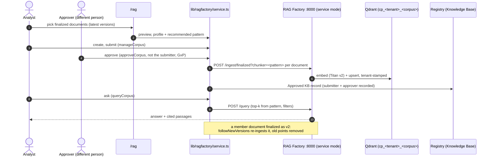

# RAG Factory module

This module turns **finalized documents** (from [Document Intelligence](../document-intelligence/README.md)) into an approved retrieval **corpus**. The steps are:

- The corpus is profiled and a retrieval pattern is recommended.
- A second person approves it.
- The approved corpus is built by the RAG Factory engine (`rag-ai-factory`, a private sidecar) into a tenant-scoped Qdrant collection.
- The collection is registered as an Approved **Knowledge Base** that agents attach through the existing `knowledgeRefs` path.

The pattern is chosen **once per corpus** and the factory **executes** it. This replaces the factory's per-query routing, which picked a pattern and then always ran dense top-k.

Design and diagrams: [../../IDP_RAG_INTEGRATION.md](../../IDP_RAG_INTEGRATION.md), section 6.

## Flow

## Patterns

| Pattern | Factory chunker | top-k | Recommended when |
|---|---|---|---|
| Structured fields + tables | `structured_chunking`: text, plus field and table-row chunks | 6 | at least half the documents have tables, or there are 5 or more fields on average, and the text is under 8,000 characters |
| Sentence window | `sentence_window_chunking`: retrieve on a sentence, answer from ±3 sentences | 8 | average text is 8,000 characters or more |
| Semantic sentences | `semantic_chunking` | 8 | average text is 2,000 characters or more |
| Fixed chunks | `fixed_chunking` (500/50) | 5 | anything else |

The recommendation comes with its reasons, and the analyst may choose another pattern. Changing the pattern or the documents of an approved corpus returns it to Draft for re-approval.

## Governed actions (tool `ragfactory`, evaluated in the corpus's tenant)

| Action | Minimum role | Used for |
|---|---|---|
| `viewCorpus` | viewer | list and read corpora and eligible documents |
| `queryCorpus` | viewer | ask a built corpus |
| `manageCorpus` | analyst | create, edit, submit, rebuild |
| `approveCorpus` | approver | approve (starts the build) or reject; never the submitter |

The permit is `pol-gw-ragfactory`. The GxP-training and data-residency forbids cover all four actions.

**Related change:** Knowledge Base retrieval (`lib/kb/service.ts`) is now evaluated in the KB record's tenant. Before this, any persona could read a tenant-owned KB directly through `/api/kb/retrieve`.

## Corpus rules

- **Members:** only finalized documents of the corpus's own tenant, and only their **latest** version.
- **New versions:**
  - With `followNewVersions` on (the default), a new finalized version of a member is re-ingested automatically. The factory removes the old version's points. No re-approval is needed: the document set is unchanged and the new version is itself four-eyes approved.
  - With it off, the new version is listed under `updatesAvailable`, and adopting it needs re-approval.
- **Builds:** each build records the trigger (`approval`, `rebuild` or `new-version`), the chunker, and per-document results. A failed incremental build leaves the previous build serving.

## Files

| File | Why it exists |
|---|---|
| `src/lib/ragfactory/model.ts` | `Corpus`, members, profile, builds. |
| `src/lib/ragfactory/patterns.ts` | The pattern catalog, `profileCorpus`, `recommendPattern` and `collectionFor`. Pure. |
| `src/lib/ragfactory/client.ts` | Service-mode client: `/ingest/finalized` (with chunker), `/query` (with filters), health. |
| `src/lib/ragfactory/service.ts` | Lifecycle and governance, background builds, KB registration, and `onDocumentFinalized`, which `docintel/service.ts` calls after every finalize. |
| `src/app/api/ragfactory/route.ts` | GET (health with patterns, list, detail, eligible documents); POST (`preview`, `create`, `update`, `submit`, `approve`, `reject`, `rebuild`, `query`). |
| `src/app/rag/page.tsx` | UI: corpus list, new-corpus builder with live profile and pattern cards, approval, builds, the registered KB, and an "Ask" panel with chunk-kind and doc-type filters and cited passages. |
| `tests/ragfactory.test.ts` | Recommendation, membership rules, four eyes, build, KB registration, failure and rebuild, version follow-through, query parameters, and tenant-scoped KB retrieval. |

## Engine changes (`rag-ai-factory`, branch `phase2/corpus-patterns`, on top of `hardening/service-mode`)

- `/ingest/finalized?chunker=`: the four chunkers above. Payloads carry `chunk_kind` and `chunker`; sentence-window chunks also carry `window_text`. Keyword payload indexes are created for the filtered fields.
- `/query`:
  - Accepts `filters`, an allowlist that excludes `tenant_id`; the tenant always comes from the header.
  - Answers from `window_text` when it is present.
- Tests: `tests/test_corpus_patterns.py`. The suite passes 33/33.

## Running it

| Component | How it runs |
|---|---|
| Sidecar | `~/.config/agentcontrol/start-raf.sh` (uvicorn on `127.0.0.1:8000`, `raf.env` mode 600). |
| Control plane | Reads `RAG_URL`, `RAG_SERVICE_TOKEN` and `QDRANT_URL` from `~/.config/agentcontrol/env`. |
| Start-up | `start.sh` starts both sidecars if they are not already running. |
