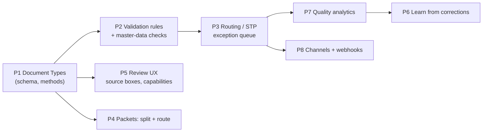

# ABBYY AI Document Processing compared with our Document Intelligence module

**Source.** I read https://www.abbyy.com/ai-document-processing/ on 2026-10-24: product page, capability sections and FAQ. This is ABBYY's own marketing, so the figures in it are vendor claims, not measurements: "90% accuracy from day one", "200+ languages", "100+ pre-built models", "35 years".

**Question.** What should we add to Document Intelligence (IDP engine + control plane) and the RAG Factory, for Takeda BUs and BFs?

---

## 1. What ABBYY offers (Vantage / Document AI)

| Area | ABBYY capability (their wording, condensed) |
|---|---|
| Capture | Ingest from mobile, **email, shared folders, network scanners**, API and connectors |
| Image quality | AI **image enhancement**: fix camera distortion, separate text from patterned backgrounds and security marks (IDs, certificates, forms) |
| OCR / ICR | Printed **and handwritten** text; logical structure, including tables |
| Classification and assembly | Multimodal (text + image) classifiers; **split and sort mixed packets**; each class is **auto-routed to its extraction model** |
| Extraction | Structured, semi-structured, unstructured; tables, handwriting, **checkmarks, barcodes, signatures**; 200+ languages |
| Validation | **Automatic validation rules**; **cross-checks against databases** |
| Models ("skills") | **Pre-trained models** in a Marketplace (100+): invoices, bank statements, tax forms, waybills, and more. Customers **tweak** them or **train custom** ones, low-code |
| LLM hybrid | Purpose-built extraction plus LLMs for summarisation, reasoning, communication |
| Human in the loop | Review UI for classes and fields, used **when validation fails or 100% accuracy is needed** |
| Continuous learning | **Every correction improves the model** |
| Quality analytics | **Straight-through-processing (STP) rate** over time, root-cause insights, recommendations |
| Process intelligence (Timeline) | Process mining, monitoring, prediction, digital twin |
| Export / integration | JSON, CSV, XML; REST API; RPA, BPM and ECM connectors; status returned to the source system |
| RAG | "AI-ready document data" to ground LLMs |
| Trust | Explainable AI; SOC 2 Type II and ISO 27001; regional hosting (US/EU/AU) |
| Solutions | AP automation, KYC/onboarding, lending, claims, logistics, **document fraud** |

## 2. Where we stand

| Capability | ABBYY | Us today | Notes |
|---|---|---|---|
| Multi-method extraction + **side-by-side comparison** (cost, latency, confidence) | — | ✅ | Ahead. ABBYY runs one model per class; we compare Claude, Nova, Textract and others per document. |
| Four-eyes finalize; GxP and residency policy; tenant isolation | partial (access controls) | ✅ | Ahead for regulated work. |
| Immutable, versioned, **hash-verified** result (`FinalizedDocument v1`) | — | ✅ | Ahead. |
| Delta (lakehouse) publication | via connectors | ✅ | |
| RAG from reviewed documents, **pattern per corpus**, KB for agents | marketing-level | ✅ | Ahead (the build is governed). |
| Human review UI with edit history (`originalValue`) | ✅ | ✅ basic | No page preview or source highlighting yet. |
| PII detection / redaction | — | ✅ (capability) | Opt-in per run. |
| **Document types with expected fields** ("skills") | ✅ core | ❌ | Each run is generic; nothing says what an invoice *must* contain. |
| **Validation rules + database cross-checks** | ✅ core | ❌ | Biggest gap. |
| **Confidence / validation-based routing (STP)** | ✅ core | ❌ | Every document goes to a person. |
| **Classify + split mixed packets, auto-route** | ✅ | ⚠️ the engine has `document_splitting` and `document_classification`; not wired | |
| Handwriting, checkboxes, barcodes, signatures | ✅ | ⚠️ in the engine (33 skills); not exposed in our UI | Our UI offers 10 of the engine's 33 capabilities. |
| Image enhancement | ✅ | ⚠️ engine `ocr_enhancement`, `format_standardization`; not exposed | |
| **Source highlighting** (field → page + box) | ✅ (XAI) | ❌ | Engine has `bounding_box_detection` and a preview endpoint. |
| **Learning from corrections** | ✅ | ❌ | We record every correction but don't reuse them. |
| **Quality analytics** (STP, correction rate) | ✅ | ❌ | All the raw data is already stored. |
| Ingestion channels (email, folders, batch) | ✅ | ❌ (browser upload only) | |
| Export CSV/XML, webhooks, status callback | ✅ | ⚠️ JSON + Delta only | |
| Fraud / tamper signals | ✅ (solution) | ❌ | |
| 200+ languages | ✅ | ⚠️ the LLMs are multilingual, but language is not recorded | |
| Process mining | ✅ (Timeline) | ❌ | Out of scope; the audit log could feed it. |

**Summary.** We are ahead on **governance, auditability and comparing methods**, which are the hard parts in a GxP company. ABBYY is ahead on **operational automation**: knowing what a document *should* contain, checking it automatically, sending only exceptions to people, and getting better from corrections.

## 3. Recommendations, in priority order

### P1. Document Types: the backbone (like ABBYY "skills", but governed)

Add a tenant-owned **Document Type** record that goes through maker-checker like everything else. Each type has:

- A **field schema**: name, type (text, number, date, money, enum), required, format (regex), allowed values, and synonyms (the label variants the model may return).
- **Default methods and capabilities**. For example, CoA uses `table_extraction` and `kv_extraction` with Sonnet; a scanned form adds `handwriting`, `checkbox` and `signature`.
- **Validation rules** (P2).
- **Routing**: confidence threshold, and whether straight-through is allowed (P3).
- The **RAG pattern** hint for corpora of this type.

**Starter catalog for Takeda**, as seeds:

| Area | Document types |
|---|---|
| Quality | Certificate of Analysis, batch record excerpt, deviation report, CAPA, change control |
| Supply | supplier invoice, purchase order, packing list, supplier qualification questionnaire |
| R&D / Clinical | site invoice, CRF page, protocol synopsis |
| Safety | adverse-event intake form |
| Enterprise | contract, NDA |

**Effect:**
- Classification picks the type, the type picks the methods, the review form shows the *expected* fields (missing ones highlighted), and the finalized record carries `docType` plus a schema-conformant `fields`.
- `FinalizedDocument` stays v1. The type id goes in `classification.docType`, and the type's version in a new optional field. This is backward-compatible (v1.1).

### P2. Validation rules and cross-checks

Rules are evaluated after extraction and on every review save:

| Kind | Examples |
|---|---|
| Field | required, format, range, date order (`expiry > manufacturing`) |
| Arithmetic | line items sum to total; tax = rate × net |
| Specification (pharma) | each CoA result lies within its specification (`99.4 %` within `95.0–105.0 %`) |
| Cross-document | invoice PO number matches an existing PO; CoA batch matches the delivery |
| **Master data** | supplier exists and is approved in the vendor master; batch exists in ERP. These run through the existing **Unity Catalog tools**, read-only and governed |

Each failure is shown on the field with a reason. **A GxP tenant cannot submit with blocking failures** unless the analyst overrides with a justification, which is recorded in the audit and in the finalized record.

### P3. Confidence- and rule-based routing (straight-through processing)

- If every required field is present, at or above its confidence threshold, and passes validation, the document is **"clean"**.
- **Clean documents** skip the analyst edit step and go straight to *pending finalization*. The checker sees "clean" with the evidence.
- **Non-GxP tenants**, with a `standard` or `exploratory` approval profile, may allow **auto-finalize** of clean documents by a service principal. That rule is itself a Cedar policy, so it is visible and auditable.
- **GxP tenants** always keep a human finalizer. STP there means less work, never no person.
- An **exception queue** in the Approval Inbox lists documents with failures or low confidence, worst first.

### P4. Packets: classify, split, route

One upload of a multi-document PDF (for example a supplier pack: invoice + CoA + packing list) uses `document_splitting` to find page ranges and creates **child jobs**, each classified to a Document Type and routed (P1). The parent keeps the relationships, so a corpus or a cross-document rule can use them.

### P5. Review UX: source highlighting and the full capability set

- **Side-by-side review:** page preview with **bounding boxes** for the selected field (`bounding_box_detection`; IDP already serves previews). This is ABBYY's "explainable AI", and for GxP reviewers it is evidence that the value came from the page.
- Expose the engine's other capabilities, grouped: handwriting, signature detection, barcode/QR, layout, language detection, OCR enhancement, image and chart description.
- Record the **language** on the finalized record and offer it as a corpus filter.

### P6. Learning from corrections, without retraining

Every edit already stores `originalValue` → `value`. From these, per Document Type:

- **Few-shot hints:** the most frequent corrections become extraction instructions, approved like everything else. For example: "dates on these CoAs are DD.MM.YYYY", or "'Lieferant' means supplier".
- **Synonym learning:** field labels that reviewers keep renaming become schema synonyms.
- **Method choice:** a type whose fields are corrected less often under Sonnet than Haiku gets Sonnet as its default.

This needs one small engine change: accept per-request extraction instructions.

### P7. Quality analytics (the STP dashboard)

From data we already store, per tenant, Document Type and method:

- STP rate, **field correction rate**, validation-failure rate
- time from upload to finalize, and how long items wait for a checker
- cost and latency per document
- "top corrected fields" with the suggested fix from P6

This is ABBYY's quality analytics. It also shows each BU/BF what IDP is worth.

### P8. Channels and outputs

| Direction | Options |
|---|---|
| In | a **watched S3 prefix** per tenant (shared folder / scanner drop), an **email intake** address (SES → S3), and a batch API. Deduplicate by sha256. |
| Out | CSV and XML exports beside JSON; a **webhook or event on finalize** (EventBridge) so SAP, Veeva or ServiceNow flows can consume results; status returned to the channel the document came from. |

### P9. Fraud and tamper signals (later)

Metadata and font inconsistencies, edited-PDF markers, duplicate invoices (same supplier, amount and date), and bank details changed against the vendor master. These are reported as validation warnings rather than a separate product.

### Beyond ABBYY: GxP specifics worth adding

- **21 CFR Part 11 / Annex 11 e-signature on finalize:** re-authenticate, record the meaning of the signature ("reviewed and approved"), and show the signature on the record. This is where Entra ID sign-in (Phase 4) is needed.
- **ALCOA+ export:** a per-document package containing the original file, all method outputs, the review diff, the signatures and the hash chain, for audits.
- **Retention policy** per Document Type.

## 4. Suggested sequence

**Status (2026-10-24).** **P1, P2, P3 and P7 are built** and verified live: real Bedrock extraction, a real Unity Catalog supplier lookup, and browser tests through CloudFront. See [../modules/document-intelligence/README.md](../modules/document-intelligence/README.md). P4–P6, P8 and P9 are not started.

**Proposed next increment:**
- **P1 + P2 + P3.** Document Types with field schemas, validation (including CoA-within-spec and invoice line-sum rules), and confidence/validation routing into the Approval Inbox. Seeded with the CoA and supplier-invoice types we have already tested.
- **P7** as a small dashboard.

Together these move the module from "extract and review everything" to "check automatically, review exceptions", which is ABBYY's core value. They keep our governance advantages and need no new infrastructure.
