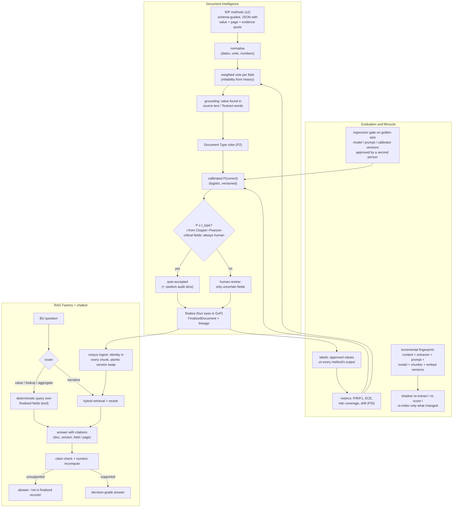

# Decision-grade accuracy across Document Intelligence, the RAG Factory and agents

**Goal (from the business).** "100% accuracy" in the document data BUs and BFs use for decisions through a chatbot.

**Inputs.**
- Three research passes on 2026-10-24: the RAG Factory repository (incremental pipeline, guards, patterns), the IDP engine repository (confidence, geometry, prompting), and the external literature and vendor practice.
- The earlier notes: [PHARMA_IDP_ML_ACCURACY.md](PHARMA_IDP_ML_ACCURACY.md) (Acodis) and [ABBYY_IDP_GAP_ANALYSIS.md](ABBYY_IDP_GAP_ANALYSIS.md).

---

## 1. What "100%" means here

No extraction model is 100% accurate. Every serious vendor gets the last step through human review: Acodis, ABBYY, Hyperscience, Microsoft and AWS all do. A target that is achievable and provable under GAMP 5, CSA and Annex 11 / draft Annex 22:

> **Zero unverified values reach a decision.**
> Every value a BU acts on satisfies all three conditions:
> 1. It was either **verified by a person** (four eyes), or **auto-accepted under a validated bound**, e.g. *precision ≥ 99.5% with 95% confidence, monitored*.
> 2. It is **traceable** to its source span, model, prompt, calibrator, rule versions and reviewer.
> 3. It is **re-verified when any of those versions change**.
>
> The chatbot answers **only** from such values, **cites** them, and **abstains** otherwise.

Critical fields (dose, lot, specification limits, release decision) can be configured to *always* need a person. Their auto-accept threshold is effectively ∞.

## 2. What the research found

### 2.1 IDP engine: no confidence number means anything

| Finding | Consequence |
|---|---|
| `confidence` is the model's self-report, or fixed fallbacks (0.95 / 0.85 / 0.8 / 0.5 / 0.3; BDA constants 0.9 / 0.6 / 0.4); `metrics.confidence` is their mean | Haiku "0.96" and Nova "0.3–0.5" carry no accuracy information. **Never route on them.** |
| No method returns geometry. Textract `Geometry`/`Confidence`/`Page` are discarded in `blocksToText`; BDA bounding boxes and blueprint `explainability_info` are not parsed | We cannot show *where* a value came from, or ground it at word level |
| Output truncated at `maxTokens` is not detected (`stopReason` ignored). It becomes "capability missing → 0.3, raw text as data" | Silent data loss |
| No schema, few-shot or tool-use output; free-form YAML/JSON parsed by 7 fallbacks; `/api/process` drops `userInstruction`; temperature 0 is already set; no prompt version | We cannot enforce our Document Type schema at extraction time, and runs are not reproducible-by-record |
| Textract runs `DetectDocumentText` only (no FORMS/TABLES/checkboxes); multi-page needs a real S3 bucket | Checkboxes and form key-values are not used; Textract fails on multi-page in local mode |

### 2.2 RAG Factory: the incremental pipeline is real; decision safety is not

| Finding | Consequence |
|---|---|
| `IncrementalPDFProcessor` hashes each page and handles add/update/delete with deterministic chunk ids. It is real and tested | A good basis for **reprocessing only what changed** |
| The page hash covers *content* only, not extractor, prompt, model, chunker or embedding versions | A model or prompt change never triggers reprocessing; stale results are invisible |
| `/ingest/finalized` re-embeds the whole new version, then deletes the old one, so **both versions are retrievable in between** | Brief cross-version answers |
| Temporal workflows are broken (wrong arguments, blocking calls, package not installed); `IncrementalRAG` is a toy | Not usable as is |
| **`AmbiguityGuard` rewrites any query that contains a negation. It runs on `/query`, which our Ask panel uses** | *"Which lots did **not** pass?"* can be answered as the opposite question. **This is a live risk today.** |
| `/query` has **no citations and no abstention**; the faithfulness score is only logged; context blocks lack doc / version / page; field chunks say only "Document fields (invoice)" | Answers cannot be attributed, and **fields from different documents can be mixed** |
| `CorrectiveRAG` answers from the model's own knowledge when nothing relevant is retrieved; several patterns ignore the tenant filter; the hybrid search is pseudo-BM25 over the dense top-k | Must fail closed before any of these patterns is enabled |
| NER normaliser bugs: `1.234,56 EUR → EUR56`, `-45.00 USD → $45.00`, US-only date order; the validator uses `.search` | Do not reuse without fixing; the control plane's parsers (P2) are already locale-aware |
| No golden set, no field-level metrics, no calibration anywhere | Accuracy is currently **unmeasured** in both repositories |

### 2.3 External practice

The essential algorithms are:
- weighted voting / Dawid–Skene across extractors;
- code-level **grounding** of every value against the source;
- feature-based **calibration** (Platt / isotonic), checked with reliability diagrams and ECE;
- auto-accept thresholds by **Learn-then-Test with Clopper–Pearson bounds**, plus a **random 2–5% audit slice** so estimates stay unbiased;
- for answers: route **structured questions to deterministic queries over validated fields**, give **mandatory span citations**, run **claim-level verification** with **numeric recomputation**, and **abstain** below calibrated thresholds;
- evaluate on a **golden Q&A set** with a regression gate;
- lineage plus **version-triggered shadow re-extraction**.

**How many verified samples a precision claim needs** (one-sided 95%, number of auto-accepted fields humans must verify):

| Target | 0 errors | 1 error | 2 errors |
|---|---|---|---|
| ≥ 99.5% | 598 | 947 | 1,258 |
| ≥ 99.9% | 2,995 | 4,742 | 6,294 |

## 3. The integrated design

## 4. Build plan, in priority order

| # | Increment | Module(s) | Why first | Effort |
|---|---|---|---|---|
| **A** | **Decision-safe answers.** Turn off the negation rewrite and the knowledge fallback for service calls; put doc / version / page / field identity in every context block; require citations; abstain on low retrieval or faithfulness scores; make the version swap atomic (filter on the current version). Add a **deterministic "finalized fields" query tool** with an intent router: lookups and aggregates answered from validated fields, never from an LLM reading chunks. Add a **claim and number check** on narrative answers. | RAG Factory, agents | It removes **live** ways the chatbot can be confidently wrong today. The field tool makes lookup questions exact by construction. | M |
| **B** | **Measured, calibrated extraction (ML-1…4).** Normalisation; per-field **weighted vote** across the methods already run; **grounding** against the extracted text; feature-based **calibrated P(correct)**; **Clopper–Pearson thresholds** per type with a minimum evidence count (no auto-accept until proven); **critical fields always human**; **random audit slice**; accuracy, ECE and risk–coverage on the Quality dashboard. | Document Intelligence | Replaces meaningless self-confidence with a measured, provable one. Straight-through processing then rests on evidence. | M |
| **C** | **Engine changes (IDP).** Per-request field schema, few-shot examples and prompt version; tool-use JSON returning `{value, page, evidence_quote}` per field; `stopReason` → *truncated*; model, prompt-hash and parse-strategy metadata; Textract word geometry and confidence plus FORMS/TABLES/checkboxes; S3 bucket for async multi-page. | IDP engine (+ deployment) | Gives B word-level grounding and geometry (reviewer highlighting, P5). Enforces our schemas at extraction time. | M–L |
| **D** | **Lineage and incremental reprocessing.** Fingerprint = content + extractor + prompt + model + calibrator + chunker + embed versions. On a version change: **shadow re-extract** the golden set → gate → re-extract affected *open* documents; finalized records get a new version only where values differ. A new calibrator **re-scores stored features without LLM calls**. Re-index only changed chunks. | DI + RAG Factory | Keeps "re-verified when versions change" true at scale, and reuses the factory's per-page hashing. | M |
| **E** | **Golden sets and regression gates.** A frozen field golden set per Document Type (from four-eyes finalized records); a golden **Q&A** set per BU (lookup / aggregate / comparison / narrative / unanswerable); gates on every model, prompt, calibrator or index change; PSI drift monitoring; ML-6 few-shot from corrections and an active-learning review queue. | All | Turns "accuracy" into a number with a confidence interval that QA can sign. | M |

**Data reality.** About 20 finalized documents exist, mostly test documents. With B, the system will **refuse to auto-accept** until each type has roughly 600+ human-verified auto-accept candidates for a 99.5% claim. That is correct GxP behaviour: straight-through processing grows with evidence. Increment A gives exact answers for lookup questions **from day one**, because those answers come from four-eyes-verified fields, not from model inference.

---

## 5. Status: increment A built and measured live (2026-10-24)

**What runs**
- **Factory `POST /query/decision`** (`rag_factory/decision_query.py`, branch `phase3/decision-safe`):
  - restricted to the tenant and the corpus's current finalized versions;
  - dense retrieval plus exact identifier matching (Qdrant full-text index), fused by RRF;
  - identity-labelled context; every sentence must cite, otherwise NOT_FOUND;
  - claim checks: citation present, every number and ID found in the cited text, then a strict entailment judge;
  - one regeneration, then abstain.
- **Factory fail-closed fixes:** negation is detected but **never rewritten**, and CorrectiveRAG **abstains** instead of answering from model knowledge.
- **Control plane** (`lib/ragfactory/planner.ts`, `fieldQuery.ts`, `service.ts`). A Bedrock planner sees field names and table columns, never values, and returns a plan through forced tool use. The plan is validated against the corpus vocabulary and **executed exactly** over four-eyes-finalized fields and tables:
  - lookups, out-of-specification rows (computed by the P2 specification parser), counts, aggregates;
  - currency guard: no answer in a currency the record does not state;
  - exact-name filters relaxed to partial match only when nothing matched, and disclosed in the answer.

  Anything else goes to the verified retrieval path.
- **UI** (RAG Factory → Ask) shows the mode (*Exact* / *Verified retrieval*), citations, each claim with ✓/✕, the query plan, and abstentions.

**Live evaluation** (`integration/rag_accuracy_eval.mjs`, golden set `integration/golden/rnd-supplier-qa.json`): 28 questions against Qdrant Cloud and Bedrock. They cover lookup, negation, aggregate, narrative, paraphrase, filter, unanswerable, and documents that exist in the tenant but not in the corpus.

| Run | Answered correctly | Wrong | Correct abstentions | Coverage | Precision (95% lower bound) |
|---|---|---|---|---|---|
| 1 (before fixes) | 15/16 answered | 0 wrong values; 1 answered in the wrong currency | 3/4 | 94% | 94% |
| 3 (after fixes) | **21/21** | **0** | **7/7** | **100%** | **100% (≥ 86.7%)** |
| 4 (repeat) | 21/21 | 0 | 7/7 | 100% | 100% |

The lower bound is honest about sample size: 28 questions prove ≥ 86.7%. Claiming ≥ 99.5% needs about 600 graded questions with zero errors, which is why the golden set must grow per BU (increment E). Every miss found so far was an **abstention or a refusal**, not a wrong value.
