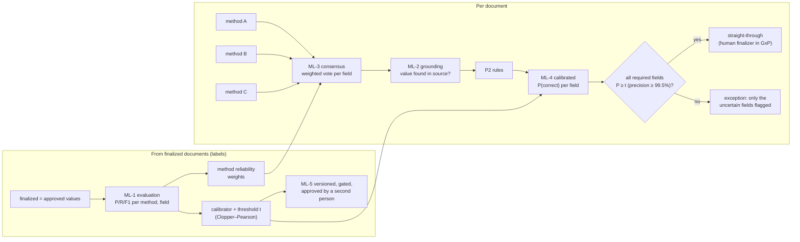

# Pharma / life-science document processing: building in ML for accuracy and precision

**Sources.** I read https://www.acodis.io/document-automation-for-life-sciences on 2026-10-24: main page and FAQ. The figures quoted from it are vendor claims, not independent measurements. I also drew on our own system (Document Intelligence: Phases 1–3 and P1–P3, P7) and on established techniques: ensemble voting, the Dawid–Skene model, probability calibration, conformal risk control, and Clopper–Pearson bounds.

**Question.** For GxP document work (CoAs, batch records, stability reports, clinical study reports), what ML should we build in so that results are **accurate** (right values) and **precise** (what we auto-accept is almost never wrong), and so that we can **prove** it to QA?

---

## 1. What a pharma-specialised IDP vendor does (Acodis)

| Theme | Acodis claim / approach |
|---|---|
| Use cases | CoA validation, stability reports, **batch record review** ("cut review time by 60%"), clinical study reports → AI-ready data, SDS, labelling, regulatory submissions |
| Models | **Models trained per document type**, and **separate models per element** (tables, signatures, handwriting, checkboxes, free text) instead of one generic engine |
| Accuracy | **96–99%+ F1** "within 20–50 training documents"; 99%+ on 1,000-page files; "generic LLMs made **21× more errors**" on batch records, mostly tables, checkboxes and signatures (their benchmark) |
| Safety | "**Never auto-accepts uncertain data**." Two layers: **confidence thresholds** *and* **validation rules** (format, range, content). Rules catch even "confident" errors |
| Determinism | "Same input, same output". Deterministic models make results auditable |
| Lifecycle | **Customer controls model versions**; old versions are never force-deprecated. Every processed document can refine the client's private model |
| Economics | Purpose-built models are about **6× cheaper per page** than general LLMs at volume |
| Compliance | ISO 27001, SOC 2, HIPAA, GDPR; validated GxP deployments; private instance per client |

**What this tells us.**

- Regulated buyers care about **measured F1 per field**, **precision at the auto-accept threshold**, **determinism**, and **version control**, more than raw capability.
- Their critique of LLMs is fair on three points: **run-to-run variation**, **poorly calibrated self-confidence**, and **table, checkbox and signature errors**.
- We see the second one in our own data. Haiku reports about 0.96 on almost everything, while Nova reports 0.30–0.50 for equally good output. Neither number is a probability of being right.

## 2. Where we stand against those criteria

| Criterion | Today | Gap |
|---|---|---|
| Confidence + rules, two layers | ✅ P2/P3 (rules, required fields, confidence threshold, exceptions) | The confidence is the model's **self-report, uncalibrated** |
| Measured accuracy (F1) per field | ❌ | We have the labels (see §3) but don't compute it |
| Precision guarantee at auto-accept | ❌ | The threshold is a guess (0.80 / 0.85), not derived from data |
| Hallucination control | ❌ | A value not present in the document is not detected |
| Several models per document | ✅ unique: we run 2–4 methods side by side | We **compare** them in the UI but don't **combine** them |
| Determinism | ⚠️ | Model IDs are pinned in IDP; temperature and prompt version are not recorded per run |
| Version control with a regression gate | ⚠️ Document Types are versioned and approved | Model / prompt versions aren't; nothing blocks an accuracy drop |
| Learning from corrections | ❌ | Corrections are stored (`originalValue → value`) but not used |
| Element-specific models (tables, checkboxes, signatures) | ⚠️ the engine has table, signature, handwriting and barcode capabilities | Not measured per element |

## 3. The key insight: we already have labelled data

Every **finalized document** is ground truth, approved by two people under GxP. For each schema field we know:

- the **approved value** (after any human correction), and
- what **every method** extracted for it, because all method runs are stored on the job, not only the selected one.

So each finalized document yields a **labelled example per field per method**: did method *m* get field *f* right? No extra labelling effort is needed, and the labels are of audit quality. This turns accuracy into something we can **measure, calibrate and guarantee**.

## 4. Recommended ML: five components, each deterministic and explainable

### ML-1. Evaluation harness (measure first)

- **Matching.** Per Document Type, field and method, normalise values: dates to ISO; numbers and units (UCUM-style: `mg`, `%`, `mL`); case and whitespace. Then compare each method's value with the approved value.
- **Metrics.** Field-level **precision, recall and F1**, plus "exact after normalisation" accuracy. Break them down by element type: plain field, table cell, checkbox, signature.
- **Golden sets.** A frozen, versioned **golden set** per type (finalized documents chosen by QA) is used for **regression gates** (ML-5).
- **Output.** A new "Accuracy" section on the Quality dashboard, plus an exportable evaluation report as evidence for computer-system validation (CSV/CSA).

### ML-2. Grounding check (stop hallucinations)

For every extracted value, check that it is **supported by the source**:
- fuzzy match of the value in the OCR/text layer (token-level, normalised);
- numeric match with tolerance;
- date in any format.

An unsupported value becomes a **"not found in the document"** issue (block for required GxP fields). This is deterministic, cheap, and targets the LLM failure mode QA fears most. It also feeds ML-3 as a feature.

### ML-3. Multi-method consensus with learned reliability (accuracy)

We already run several methods. The idea is to combine them:

- **Agreement:** per field, the share of methods that agree with the chosen value after normalisation.
- **Weighted vote:** each method's vote is weighted by its **historical accuracy for that type and field** (from ML-1). This is a simplified **Dawid–Skene** model: learn each annotator's reliability, then infer the most likely true value.
- **Result per field:**
  - the **consensus value**, which can come from a different method than the one selected for review;
  - an **agreement score**;
  - "**methods disagree**" when the top two candidates are close. That case goes to a person, and it is exactly the case a single model would get wrong silently.

### ML-4. Calibrated confidence + precision-guaranteed thresholds (precision)

**Calibrated probability.**

- Replace self-reported confidence with **P(correct)** from a small, explainable model per Document Type: **logistic regression**, or isotonic regression as an option. It is trained on the ML-1 labels.
- Features:
  - self-confidence
  - method agreement (ML-3)
  - grounding score (ML-2)
  - whether the type's rules pass
  - format validity
  - field type and element type
  - text length / OCR quality
- The model is a handful of coefficients. Training is deterministic and versioned, and each prediction is explainable ("agreement 1/3 lowered it").

**Threshold with a guarantee.** For each type (or field group), choose the auto-accept threshold *t* so that **precision ≥ target** (for example **99.5%** for GxP, 98% otherwise) **with 95% confidence**:

- Use the **Clopper–Pearson lower bound** on a held-out calibration split: the smallest *t* whose accepted set has `LB(precision) ≥ target`. This is conformal / risk-controlled selection.
- **Too little data** (for example, fewer than about 30 labelled fields above *t*) means **no auto-accept**. The system says so instead of guessing. This is Acodis's "never auto-accept uncertain data", made **quantitative and auditable**.

**Effect on routing.** P3's straight-through rule changes from "self-confidence ≥ 0.85" to "every required field has P(correct) ≥ *t*, which has proven precision ≥ 99.5%". The finalized record stores *t*, the target, the bound and the model version.

### ML-5. Determinism, versioning and a regression gate (control)

- **Per run, record** the model ID, temperature (0), prompt or skill version hash, and engine version.
- **Version the calibrator and thresholds** with the Document Type: draft, evaluate, publish by a second person, exactly like types today.
- **Gate:** a new model, prompt or calibrator version may be published only if it **does not reduce F1 or precision-at-threshold on the golden set** beyond a tolerance. The evaluation report is attached to the approval.
- **Stability check:** re-run a sample twice and report the **disagreement rate** between runs as a published metric. This answers the "same input, same output" question honestly for LLM methods.

### Later (data volume permitting)

- **ML-6, few-shot from corrections.** For a new document, retrieve the 2–3 most similar finalized documents of the same type and give their approved values to the LLM as examples. This is in-context learning without training, and is usually a large accuracy gain on recurring layouts. It needs one small IDP engine change: accept examples per request.
- **ML-7, specialised element models.** Once a type has about 50+ finalized documents, fine-tune layout models (for example LayoutLMv3 or Donut on SageMaker or Databricks) for **tables, checkboxes and signatures**, which are the elements the vendor benchmark says LLMs miss. They run as an additional "method", so ML-3 and ML-4 absorb them automatically. This is the Acodis approach, added to our ensemble instead of replacing it.
- **Pharma normalisation:**
  - **units**: UCUM
  - **dosage forms and routes**: EDQM standard terms
  - **substances**: IDMP / GSRS UNII
  - **adverse events**: MedDRA, for AE intake
  - **specifications**: pharmacopoeia references (Ph. Eur. / USP), already partly parsed in P2

## 5. How it fits together

## 6. What this buys, and what it costs

| | Benefit | Effort |
|---|---|---|
| ML-1 evaluation | Accuracy becomes a **number per field**, and validation evidence for QA | small (pure TypeScript over stored data) |
| ML-2 grounding | Catches invented values deterministically | small |
| ML-3 consensus | Higher accuracy from methods we already pay for; flags disagreement | small–medium |
| ML-4 calibration + thresholds | **Provable precision** at auto-accept; STP is only as high as the data justifies | medium (logistic regression + bounds in TypeScript; no new infrastructure) |
| ML-5 versioning + gate | Determinism and change control for CSV/CSA | medium |
| ML-6 few-shot | Accuracy on recurring layouts | small engine change |
| ML-7 fine-tuned element models | Tables, checkboxes, signatures; lower cost per page | large (SageMaker/Databricks, labelled volume) |

**Honest constraint.** Calibration and thresholds need real volume. We have about 20 finalized documents, mostly synthetic test documents. With the guarantee in ML-4, the system will **refuse to auto-accept** until each type has enough labelled fields. That is the correct behaviour for GxP: STP grows as evidence accumulates, never ahead of it.

**Recommendation.** Build **ML-1 → ML-4** next as one increment. It is all in the control plane, uses stored data, needs no new infrastructure, and is deterministic and explainable. ML-5 should follow as part of the same release, so that the calibrator and thresholds are versioned and approved like Document Types.
